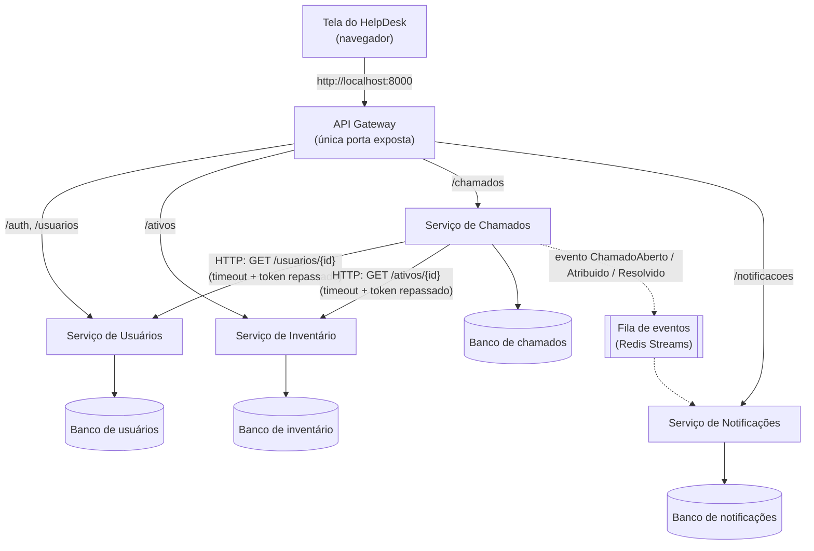
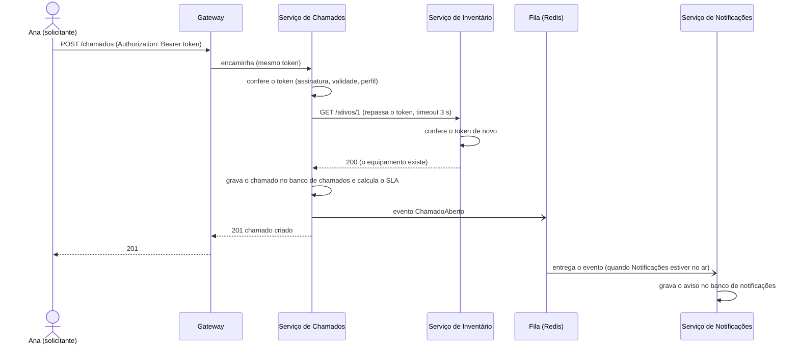

# HelpDesk TI · microsserviços

> 🎥 **Vídeo de demonstração (4 a 6 min):**(https://youtu.be/i98mg8wMKdI)
> (o roteiro para gravar está em [docs/ROTEIRO_VIDEO.md](docs/ROTEIRO_VIDEO.md))

Sistema de chamados de TI (no estilo de um GLPI simplificado), em **Python + FastAPI**.
Este repositório é a resposta ao [desafio](DESAFIO.md) de Arquitetura de Software: o **monólito**
(uma aplicação, um banco, uma implantação) foi dividido em **microsserviços**, sem perder nenhuma funcionalidade.

- Abrir chamados com prioridade e prazo de atendimento (SLA: crítica 4 h, alta 8 h, média 24 h, baixa 72 h).
- Atribuir a técnicos, mudar o status (aberto → em atendimento → resolvido → fechado), comentar.
- Painel com totais por status e chamados atrasados.
- Cadastro de usuários e de equipamentos; login com perfis (solicitante, técnico, administrador).
- Notificações quando um chamado é aberto, atribuído ou resolvido.

## Arquitetura



As linhas tracejadas são o **bônus** (notificações por evento). Só o gateway é alcançável de fora do
Docker; tudo o mais fica em uma rede interna.

### Os serviços

| Serviço | Responsabilidade | Banco (volume) | Fala com |
|---|---|---|---|
| **gateway** | Entrega a tela, encaminha as rotas, trata serviço fora do ar, `/saude` agregado | nenhum | todos os serviços |
| **usuarios** | Cadastro de pessoas, **login e emissão do token JWT** | `dados_usuarios` | ninguém |
| **inventario** | Equipamentos de TI (computadores, impressoras...) | `dados_inventario` | ninguém |
| **chamados** | Chamados, comentários, SLA, status, painel | `dados_chamados` | usuarios e inventario (HTTP), fila (eventos) |
| **notificacoes** (bônus) | Reage aos eventos e grava os avisos | `dados_notificacoes` | fila (eventos) |
| **redis** (bônus) | Fila de eventos (Redis Streams) | `dados_fila` | chamados e notificacoes |

Cada serviço é um **projeto próprio** (`gateway/` e `servicos/*/`), com `Dockerfile`, `requirements.txt`
e testes, e **pode ser iniciado sozinho**.

### O que acontece ao abrir um chamado com equipamento



Se o Inventário não responder, o Chamados devolve **503** com uma mensagem clara **antes de gravar
qualquer coisa**; se a Notificações estiver fora, o chamado é aberto do mesmo jeito e o aviso espera na fila.

## Como rodar

Precisa só de Docker com Compose. **Um comando sobe tudo** (serviços, bancos, fila e gateway), sem ajustes manuais:

```bash
docker compose up --build
```

Depois abra **http://localhost:8000** (a tela). Para conferir os contêineres:

```bash
docker compose ps            # todos "healthy"; só o gateway mostra porta publicada
curl http://localhost:8000/saude   # quais serviços estão no ar
```

Opcional: `cp .env.example .env` para trocar o segredo dos tokens, a senha dos usuários de exemplo
ou a validade do login. Sem `.env`, o segredo dos tokens é **gerado sozinho** na primeira subida
(fica no volume `segredo`, nunca no código nem no Git).

Para desligar: `docker compose down` (os bancos ficam nos volumes). Para apagar tudo, inclusive os
bancos e o segredo: `docker compose down -v`.

### Rodar um serviço sozinho

```bash
docker compose up --build usuarios                 # só o serviço de Usuários (e o gerador de segredo)

# ou sem Docker, por exemplo o Chamados (Python 3.11 ou mais novo):
cd servicos/chamados
pip install -r requirements-dev.txt
JWT_SEGREDO=$(python -c "import secrets; print(secrets.token_urlsafe(48))") uvicorn app.main:app --port 8003
```

Fora do Docker, cada serviço usa um arquivo SQLite local e a documentação Swagger fica em `/docs` na
porta do próprio serviço (dentro do Docker, os serviços não publicam porta e o gateway não expõe `/docs`).
O Chamados sobe mesmo sem os outros: ele só reclama (503) quando precisa deles.

### Contas de acesso

Não é preciso criar conta: cada serviço já começa com seus dados de exemplo (`DADOS_EXEMPLO=1`, o padrão).
Todos os usuários usam a senha **`Helpdesk2026`**.

| E-mail | Perfil | O que pode fazer |
|---|---|---|
| `admin@empresa.com` | Administrador | Tudo, inclusive cadastrar usuários |
| `carla@empresa.com` | Técnica | Ver todos os chamados, atribuir, resolver e cadastrar equipamentos |
| `diego@empresa.com` | Técnico | O mesmo que a Carla |
| `ana@empresa.com` | Solicitante | Abrir chamados e ver só os próprios |
| `bruno@empresa.com` | Solicitante | O mesmo que a Ana |

Para testar o fluxo completo (abrir, atribuir, resolver, fechar), entre como **Carla**. Para testar as
permissões, entre como **Ana**: ela não vê os chamados do Bruno. As contas têm senha conhecida e servem
só para aula; em produção, use `DADOS_EXEMPLO=0`.

### Perfis e permissões (iguais às do monólito)

| Ação | Solicitante | Técnico | Administrador |
|---|:-:|:-:|:-:|
| Abrir chamado | ✅ | ✅ | ✅ |
| Ver chamados | só os seus | todos | todos |
| Comentar | nos seus | todos | todos |
| Atribuir e resolver | ❌ | ✅ | ✅ |
| Fechar ou reabrir um chamado resolvido | os seus | ✅ | ✅ |
| Cadastrar equipamentos | ❌ | ✅ | ✅ |
| Cadastrar usuários | ❌ | ❌ | ✅ |

## Rotas (todas pelo gateway, `http://localhost:8000`)

Todas exigem login (`Authorization: Bearer <token>`), exceto `/auth/login` e `/saude`.

| Método | Rota | Serviço | O que faz | Quem pode |
|---|---|---|---|---|
| POST | `/auth/login` | usuarios | Entra e recebe o token | Todos |
| GET | `/auth/eu` | usuarios | Dados de quem está logado | Logado |
| POST / GET | `/usuarios` | usuarios | Cria (admin) / lista (sem e-mail) | Admin / logado |
| GET | `/usuarios/{id}` | usuarios | Dados públicos de um usuário | Logado |
| POST / GET | `/ativos` | inventario | Cria / lista equipamentos | Técnico e admin / logado |
| GET | `/ativos/{id}` | inventario | Um equipamento | Logado |
| POST / GET | `/chamados` | chamados | Abre / lista (solicitante vê só os seus) | Logado |
| GET | `/chamados/painel` | chamados | Totais por status e atrasados | Logado |
| GET | `/chamados/{id}` | chamados | Um chamado | Envolvidos |
| PATCH | `/chamados/{id}/atribuir` | chamados | Atribui a um técnico | Técnico e admin |
| PATCH | `/chamados/{id}/status` | chamados | Muda o status | Técnico e admin (solicitante: fechar ou reabrir) |
| POST | `/chamados/{id}/comentarios` | chamados | Comenta | Envolvidos |
| GET | `/notificacoes` | notificacoes | Minhas notificações | Logado |
| GET | `/saude` | gateway | Quais serviços estão no ar | Todos |

## E se um serviço cair?

Com `docker compose stop inventario`:

| Ação | Resultado |
|---|---|
| Entrar, listar usuários, listar/consultar chamados, painel, comentar, mudar status | ✅ continua funcionando (não dependem do Inventário) |
| Abrir chamado **sem** equipamento | ✅ funciona |
| Abrir chamado **com** equipamento | ⚠️ **503** "O serviço de Inventário está indisponível no momento" (nada é gravado) |
| Listar equipamentos | ⚠️ 503 (a tela mantém a lista que já tinha e mostra o aviso) |
| `GET /saude` | mostra `inventario: fora do ar` (e a tela mostra isso no topo) |

Com `docker compose start inventario` tudo volta ao normal sozinho. O mesmo vale para o serviço de
Usuários (atribuir chamado dá 503; o resto continua) e para a Notificações (os chamados continuam
abrindo e os avisos esperam na fila).

## Segurança

Resumo (detalhes e limites em [SECURITY.md](SECURITY.md)):

- **Todo serviço confere o token** JWT antes de responder; o segredo `JWT_SEGREDO` vem do `.env` (ou é
  gerado e guardado em volume), nunca do código. Sem segredo válido o serviço não inicia.
- **Permissões por perfil mantidas**: o solicitante só vê os próprios chamados, e assim por diante.
- **O token do usuário é repassado** quando o Chamados chama outro serviço.
- **Só o gateway está exposto** (`127.0.0.1:8000`); serviços, bancos e Redis ficam em rede interna.
- Contêineres sem root, somente leitura e sem capacidades extras; cabeçalhos de segurança e CSP na tela.

## Testes

Cada serviço tem os seus testes, que rodam sozinhos (sem os outros serviços e sem Redis: os vizinhos
são substituídos por versões de mentira, e a rede, por um servidor falso):

```bash
cd servicos/usuarios && pip install -r requirements-dev.txt && pytest -q
cd servicos/inventario   # idem
cd servicos/chamados     # idem
cd servicos/notificacoes # idem
cd gateway               # idem
```

Incluem **testes de segurança** (token falso, vencido, `alg: none`, de outro segredo e de perfil
desconhecido; permissões por perfil; campos extras; limites de tamanho) e de **falhas** (timeout, serviço
fora do ar, erro 5xx, fila fora do ar). A cada envio ao GitHub, o **GitHub Actions** roda os testes de
cada serviço separadamente, o `pip-audit` confere as dependências e o `docker compose config` valida o compose.

Com o sistema no ar, o script `scripts/teste_integracao.py` (só biblioteca padrão) percorre o fluxo completo
pelo gateway: segurança, permissões, abrir → atribuir → resolver → fechar e notificações. Com `--falha`,
ele também para e religa o Inventário:

```bash
python scripts/teste_integracao.py
python scripts/teste_integracao.py --falha
```

## Decisões que tomei

1. **Um repositório, vários projetos.** Cada serviço tem seu `Dockerfile`, dependências e testes; o código
   de um não importa o do outro. Ficou fácil de revisar e de subir com um comando.
2. **Um banco por serviço, sem chaves estrangeiras entre eles.** Cada serviço tem seu arquivo SQLite em um
   volume próprio, e nenhum monta o volume de outro. O Chamados guarda só o **número** do solicitante, do
   técnico e do equipamento; quem confere se eles existem é uma chamada HTTP, na hora. Trocar para
   PostgreSQL é só mudar `DATABASE_URL` (continua SQLAlchemy). Consequência aceita: não há mais
   integridade garantida pelo banco entre serviços.
3. **Login em um serviço só; todos conferem.** O serviço de Usuários emite o token (HS256); Inventário,
   Chamados e Notificações o **conferem** localmente (assinatura, validade, emissor, perfil), sem perguntar
   ao Usuários a cada chamada. Assim o Inventário não depende de ninguém. O custo: o perfil vem do token, então
   uma conta desativada continua valendo até o token vencer (60 min). O Usuários, dono dos dados, sempre
   confere o banco. A conferência do token é um arquivo pequeno **copiado** em cada serviço, em vez de uma
   biblioteca compartilhada: assim os serviços continuam independentes (ao custo de duplicar ~30 linhas).
4. **Segredo gerado se faltar, mas nunca no código.** O monólito inventava um segredo aleatório por processo;
   com vários serviços isso quebraria a conferência. Agora o serviço **não inicia** sem um segredo de 32+
   caracteres. Para o `docker compose up --build` funcionar sem ajuste manual, um contêiner de uso único
   (`segredo`) gera o segredo na primeira subida e o guarda em um volume lido só pelos serviços que conferem
   tokens (o gateway não o recebe). Se houver `JWT_SEGREDO` no `.env`, ele vale no lugar do gerado.
5. **Chamados fala com Usuários e Inventário por HTTP síncrono** (`httpx`), porque precisa da resposta para
   decidir. Toda chamada tem **timeout** (3 s; 1,5 s para conectar), **repassa o token** e transforma falha
   de rede, timeout e erro 5xx em **503** claro. A conferência acontece **antes** de gravar, então uma falha
   não deixa nada pela metade. "Não existe" continua sendo 404, como no monólito. Não implementei nova
   tentativa nem *circuit breaker* (veja os próximos passos).
6. **Eventos em Redis Streams, não em publicar/assinar simples.** O stream **guarda** as mensagens: se a
   Notificações cair, os avisos esperam e chegam quando ela voltar (grupo de consumidores, `XACK`). A entrega é
   "pelo menos uma vez", então o consumidor é **idempotente** (cada evento tem um `id` único, gravado junto do
   aviso). O evento leva **fatos** (`chamado_id`, `solicitante_id`...); quem monta o texto da mensagem e escolhe
   o destinatário é a Notificações, dona desse assunto. O Chamados publica **depois** de salvar e nunca falha
   por causa da fila.
7. **Gateway próprio (Starlette + `httpx`) em vez de Nginx.** Precisava entregar a tela, devolver erros em
   JSON, agregar o `/saude` e impor limites; o Starlette é a base do FastAPI e deixa tudo isso em código
   testável. O gateway é uma **lista de permissão** de rotas, recusa caminhos como `/chamados/../usuarios`,
   repassa só cabeçalhos conhecidos, limita o corpo (mesmo sem `Content-Length`) e **define o IP do cliente**
   em `X-Forwarded-For` (o limite de tentativas de login usa isso). Ele **não** confere token: isso é de
   cada serviço (defesa em profundidade).
8. **Duas redes Docker.** `publica` (só o gateway) e `interna` (`internal: true`: sem acesso de fora nem à
   internet). Só o gateway publica porta, e apenas em `127.0.0.1`.
9. **Dados de exemplo por serviço.** Cada serviço semeia o seu banco. Os chamados de exemplo apontam para ids
   conhecidos dos outros dois (Ana = 2, Bruno = 3, Carla = 4; equipamentos 1 e 2) **sem chamadas de rede**,
   então o Chamados sobe mesmo que os vizinhos ainda estejam iniciando.
10. **Mesmas regras de negócio.** SLA, transições de status, permissões e mensagens de erro foram mantidos;
    as correspondências com os comentários `# vira chamada HTTP` / `# vira evento` do monólito estão em
    `servicos/chamados/app/chamados/servico.py`.

## O que mudou em relação ao monólito

**Ficou melhor**

- **Publicação independente**: dá para atualizar o Inventário sem mexer em Chamados ou Usuários.
- **Falha isolada**: com o Inventário fora, o resto do sistema segue funcionando (veja a tabela acima).
- **Escala e tecnologia por serviço**: dá para ter mais cópias só do Chamados, ou outro banco só para o Inventário.
- **Times autônomos**: cada parte tem dono, banco e testes próprios; as fronteiras são rotas HTTP e eventos,
  não funções.

**Ficou mais difícil**

- **A rede entrou no meio**: uma chamada de função que não falhava virou uma chamada HTTP que demora, falha e
  precisa de timeout, tratamento de erro e mensagem para o usuário.
- **Consistência**: não há mais uma transação nem chave estrangeira cobrindo tudo. Um chamado pode apontar para
  um técnico que depois deixou de existir; a verificação só acontece no momento da atribuição.
- **Segurança em mais lugares**: o token é conferido em cada serviço, o segredo é compartilhado e a rede
  interna precisa ser protegida.
- **Operar e depurar**: sete contêineres em vez de um, logs espalhados (o gateway põe um `X-Request-ID` em cada
  chamada para ajudar) e testes de ponta a ponta mais trabalhosos.
- **Duplicação**: a conferência do token e a configuração se repetem em cada serviço.

## Limitações conhecidas e próximos passos

- **Eventos podem se perder** se o Redis estiver fora do ar no instante em que o chamado é salvo (o chamado
  vale, mas o aviso não é enviado). A solução é o padrão *outbox*: gravar o evento no mesmo banco, na mesma
  transação do chamado, e um processo o publicar depois.
- **Sem nova tentativa nem *circuit breaker*** nas chamadas entre serviços: cada falha custa até o timeout.
  Um *circuit breaker* evitaria insistir em um serviço que já se sabe estar fora.
- **Token de conta desativada vale até vencer** nos serviços sem banco de usuários (veja SECURITY.md); chave
  assimétrica e lista de revogação seriam o próximo passo.
- **Sem HTTPS, Redis sem senha e SQLite**: adequados para aula; veja "Antes de usar em produção" em SECURITY.md.
- **Horários**: como no monólito, as datas são gravadas sem fuso horário e os contêineres rodam em UTC; o
  prazo do SLA está correto, mas o horário mostrado na tela segue o relógio UTC dos contêineres.

## Estrutura do repositório

```
.
├── docker-compose.yml        # sobe tudo: gateway, 4 serviços, Redis e o gerador de segredo
├── .env.example              # configuração opcional
├── gateway/                  # API Gateway (Starlette + httpx) e a tela (app/web)
│   ├── app/{main,config,seguranca_http}.py
│   └── tests/
├── servicos/
│   ├── usuarios/             # login, emissão de tokens, cadastro de pessoas
│   │   └── app/{auth,usuarios,main,config,database,...}
│   ├── inventario/           # equipamentos
│   ├── chamados/             # chamados; app/clientes.py (HTTP) e app/eventos.py (fila)
│   └── notificacoes/         # consumidor de eventos e consulta de avisos
├── scripts/teste_integracao.py
├── docs/                     # roteiro do vídeo e imagens do monólito de origem
├── .github/workflows/        # testes de cada serviço + pip-audit + validação do compose
├── DESAFIO.md  SECURITY.md  README.md
```

Cada pasta de serviço tem `Dockerfile`, `requirements.txt`, `requirements-dev.txt`, `pytest.ini`, `app/` e `tests/`.

As telas são as mesmas do monólito de origem, acrescidas de um indicador de **serviços no ar** no topo
(imagens do monólito em `docs/monolito/`).

## Checklist do desafio

| Requisito | Onde está |
|---|---|
| 1. Três serviços separados, cada um um projeto, no seu contêiner, iniciável sozinho | `servicos/usuarios`, `servicos/inventario`, `servicos/chamados` (+ `notificacoes`) |
| 2. Um banco por serviço, sem FK entre serviços | volumes `dados_*` no compose; `servicos/chamados/app/chamados/modelos.py` (ids sem chave estrangeira) |
| 3. Chamados confere técnico e equipamento por HTTP | `servicos/chamados/app/clientes.py`, usado em `chamados/servico.py` |
| 4. Falha de serviço: erro claro (503) e `timeout` | `clientes.py` (timeouts, `ServicoIndisponivel`), `main.py` (handler 503); testes em `tests/test_falhas.py` e `tests/test_clientes.py` |
| 5. API Gateway na porta 8000; a tela funciona por ele | `gateway/` (serve a tela e encaminha as rotas) |
| 6. `docker compose up --build` sobe tudo | `docker-compose.yml` |
| 7. Mesmas funcionalidades e regras (SLA, status) | `servicos/chamados/app/chamados/servico.py`; testes em `tests/test_chamados.py` |
| 8. Segurança mantida | token conferido em todo serviço (`app/auth/`), perfis, token repassado, só o gateway exposto, segredo fora do código, testes de segurança em cada serviço; [SECURITY.md](SECURITY.md) |
| 9. README com diagrama, como rodar e decisões | este arquivo |
| Vídeo de 4 a 6 min | link no topo; roteiro em [docs/ROTEIRO_VIDEO.md](docs/ROTEIRO_VIDEO.md) |
| Bônus: eventos, testes por serviço, rota de saúde | `servicos/notificacoes` + Redis; `tests/` e GitHub Actions; `GET /saude` em cada serviço e no gateway |
